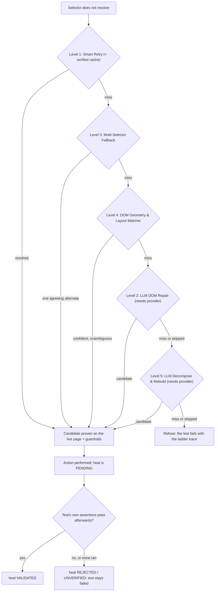

# AgentQA — Complete User & Architecture Guide

Welcome to **AgentQA**, the autonomous AI QA engineering platform for web applications. AgentQA combines a Manifest V3 Chrome Extension recorder, an asynchronous FastAPI backend with multi-LLM intelligence, a self-healing Playwright execution runner, and a modern Next.js dashboard.

---

## 📑 Table of Contents
1. [Architecture Overview](#architecture-overview)
2. [Quickstart in 3 Minutes](#quickstart-in-3-minutes)
3. [Component Walkthrough](#component-walkthrough)
   - [A. Chrome Extension Recorder (MV3)](#a-chrome-extension-recorder-mv3)
   - [B. FastAPI AI Backend Service](#b-fastapi-ai-backend-service)
   - [C. Next.js 14 Dashboard](#c-nextjs-14-dashboard)
   - [D. Playwright Runner & Self-Healing Ladder](#d-playwright-runner--self-healing-ladder)
4. [Step-by-Step Workflow Guide](#step-by-step-workflow-guide)
   - [Step 1: Record a Flow](#step-1-record-a-flow)
   - [Step 2: AI-Polished Page Object Model Generation](#step-2-ai-polished-page-object-model-generation)
   - [Step 3: Run Self-Healing Playwright Tests](#step-3-run-self-healing-playwright-tests)
   - [Step 4: Inspect Live Metrics in Dashboard](#step-4-inspect-live-metrics-in-dashboard)
5. [Self-Healing Deep Dive (5-Level Escalation)](#self-healing-deep-dive-5-level-escalation)
6. [Usage Scenarios (A to D)](#usage-scenarios-a-to-d)
7. [CI/CD & Alert Webhooks (GitHub Actions, Slack, Jira)](#cicd--alert-webhooks)
8. [Data-Driven Testing & Parameterization](#data-driven-testing--parameterization)
9. [Ground-Truth Evaluation Benchmark](#ground-truth-evaluation-benchmark)

---

## Architecture Overview

```text
┌─────────────────────────────────────────────────────────────────┐
│                    CHROME EXTENSION (Recorder)                  │
│  • Captures clicks, inputs, scrolling, navigation & forms       │
│  • Generates prioritized locators: TestID → ARIA → ID → CSS     │
│  • Exports Playwright (TS/Py), Cypress, Selenium & JSON         │
└───────────────────────────────┬─────────────────────────────────┘
                                │ REST / WebSocket
                                ▼
┌─────────────────────────────────────────────────────────────────┐
│                 FASTAPI BACKEND & AI GENERATOR                  │
│  • Ingests recordings & normalizes event sequences              │
│  • LLM Gateway: Google Gemini, Anthropic Claude, OpenAI, Ollama │
│  • Page Object Model (POM) synthesizer with assertions          │
│  • 5-Level Self-Healing Engine & Component Fingerprint Cache    │
└──────────────┬──────────────────┬─────────────────┬─────────────┘
               │                  │                 │
               ▼                  ▼                 ▼
┌────────────────────────┐ ┌──────────────┐ ┌────────────────────┐
│   NEXT.JS DASHBOARD    │ │ SELECTOR DB  │ │ PLAYWRIGHT RUNNER  │
│  • Real-time KPIs      │ │ Redis Cache  │ │ • DOM Compressor   │
│  • Healing Inspector   │ │ PostgreSQL   │ │ • Healing Ladder   │
│  • Visual Regression   │ │ (agentqa.db) │ │ • Custom Reporter  │
│  • Flaky Quarantine    │ └──────────────┘ └────────────────────┘
└────────────────────────┘
```

---

## Quickstart in 3 Minutes

### 1. Start the Backend API
```powershell
cd e:\project\projects\AgentQA\backend
python -m uvicorn src.main:app --port 8000 --reload
```
API Documentation will be live at: `http://localhost:8000/docs`

### 2. Launch the Next.js Dashboard
```powershell
cd e:\project\projects\AgentQA\dashboard
npm run dev
```
Open your browser at: `http://localhost:3000`

### 3. Install the Chrome Extension
1. Open Google Chrome and go to `chrome://extensions/`.
2. Toggle on **Developer mode** in the top-right corner.
3. Click **Load unpacked** and select the folder:
   `e:\project\projects\AgentQA\extension`
4. The **AgentQA** icon will appear on your Chrome toolbar.

---

## Component Walkthrough

### A. Chrome Extension Recorder (MV3)
Located in [`extension/`](file:///e:/project/projects/AgentQA/extension/)
- **Capture-Phase Interceptor**: Listens in `useCapture = true` mode, preventing apps from swallowing events via `stopPropagation()`.
- **Shadow DOM Piercing**: Uses `event.composedPath()[0]` to capture the true active node inside Web Components.
- **Keystroke Debouncing**: Collapses sequential keystrokes into an atomic `change` action after 400ms of inactivity.
- **Sensitive Data Masking**: Masks `password` inputs and credit card fields automatically.
- **Scroll & Form Submit Recording**: Tracks scroll coordinates `(scrollX, scrollY)` and form dispatch events.
- **Export Options**: One-click download as Playwright (TypeScript/Python), Cypress, Selenium, or Puppeteer Replay JSON.

### B. FastAPI AI Backend Service
Located in [`backend/`](file:///e:/project/projects/AgentQA/backend/)
- **Authentication**: JWT access & refresh tokens plus `X-API-Key` headers (`sk_live_...`) for CI/CD runners.
- **Multi-LLM Gateway**: Connects to Gemini, Claude, GPT-4o, or local Ollama with automatic fallback chaining and offline rule engines.
- **Self-Healing Engine (server side)**: the verified selector cache and the LLM levels (2 and 5); the deterministic levels (1, 3, 4) run in the runner against the live page.
- **Cross-Repo Intelligence**: Selectors are indexed by both `(url_pattern, selector_hash)` and `component_fingerprint` to share fixes across projects.

### C. Next.js 14 Dashboard
Located in [`dashboard/`](file:///e:/project/projects/AgentQA/dashboard/)
- Built with **Next.js 14 App Router**, **TypeScript**, and **Tailwind CSS**.
- **Overview**: Pass rates and self-healing events from the backend, or the bundled real demo and benchmark results in demo mode (`NEXT_PUBLIC_DEMO_MODE=true`).
- **Test Runs (`/runs`)**: Full run histories with expandable trace drawers and healing details.
- **Self-Healing Cache (`/healing`)**: Inspector for before/after selectors, confidence ratings, and manual accept/reject actions.
- **Visual Regression (`/visual`)**: The backend compares encoded image bytes per branch/environment; decoded-pixel and AI semantic diffing are not implemented. Real checkout screenshots are on `/evidence`.
- **Flaky Quarantine (`/flaky`)**: Tracks non-deterministic test suites and toggles quarantine to protect PR pipelines.
- **Coverage-Gap Analyzer (`/coverage`)**: Discovered sitemaps vs tested flows with route coverage percentages.
- **Data-Driven Studio (`/data-driven`)**: Bind CSV/JSON datasets to parameterized Playwright specs.
- **Settings (`/settings`)**: LLM provider switching, API keys, and Slack/Jira webhook alerts.

### D. Playwright Runner & Self-Healing Ladder
Located in [`runner/`](runner/)
- **Fixtures** (`src/fixtures.ts`): `test` / `expect` with an `agentqa` fixture (`click`, `fill`, `check`, `selectOption`, `press`, `hover`). A selector that breaks is repaired by the ladder; the repair counts only if the test's own assertions pass afterwards.
- **Ladder** (`src/healing/ladder.ts`): Levels 1, 3, 4 run offline at $0.00; Levels 2 and 5 call the backend's LLM gateway only if a provider is configured, and are skipped otherwise.
- **DOM Compressor**: strips scripts, styles, media and framework class noise and collapses long runs of look-alike siblings (the demo shop's 44KB page becomes about 1.7KB).
- **Reporter** (`src/reporters/agent-reporter.ts`): writes `agentqa-report.json` (per-test heals with verdicts, refusals, named assertion steps) and can publish validated results to the backend.

---

## Step-by-Step Workflow Guide

### Step 1: Record a Flow
1. Navigate to the web application you want to test (e.g. `http://localhost:3000` or your staging site).
2. Click the **AgentQA Extension** icon and select **Start Recording**.
3. A discreet red badge `REC` will appear on the toolbar and a floating indicator will show in the bottom-right corner.
4. Interact with your web page (click buttons, fill text, scroll, submit forms).
5. Open the popup to see recorded actions streaming live. Click **Stop**.

### Step 2: AI-Polished Page Object Model Generation
In the extension popup:
- Click **"✨ Polish with AI Backend"**.
- The backend normalizes the steps, groups actions by URL boundaries, and synthesizes a production-grade **Page Object Model (POM)** TypeScript file:
  ```typescript
  export class LoginPage {
    readonly page: Page;
    constructor(page: Page) { this.page = page; }
    async fillInput0(val: string) { await this.page.getByTestId('email-input').fill(val); }
    async clickAction1() { await this.page.getByRole('button', { name: 'Sign In' }).click(); }
  }
  ```
- The polished `.spec.ts` file downloads to your machine.

### Step 3: Run Self-Healing Playwright Tests
Copy the test into the runner:
```powershell
cd e:\project\projects\AgentQA\runner
npm test
```
**What happens when a UI redesign breaks a selector?**
1. The fixture waits briefly for the selector; it does not resolve.
2. The ladder runs cheapest first: Level 1 (retry), Level 3 (selectors recorded when the element last worked), Level 4 (DOM geometry and layout match). Levels 2 and 5 (LLM) run only if a provider is configured.
3. Each candidate must resolve to exactly one visible, enabled element and pass the intent guardrails (no *Place order* to *Cancel*, minimum confidence, no ambiguity).
4. The action is performed and the heal is **pending** until the test's own assertions pass afterwards. If they fail, or none ran, the heal is not counted and the test fails.
5. Validated heals update the remembered fingerprint and, through the backend, the verified selector cache.

Try the whole story offline with `python demo.py` (see [`TRY_IT.md`](TRY_IT.md)).

### Step 4: Inspect Live Metrics in Dashboard
Open `http://localhost:3000` to inspect:
- Total runs and pass rate percentage.
- The **Self-Healing Selector Intelligence** table showing the broken locator, repaired locator, and confidence score.

---

## Self-Healing Deep Dive (5-Level Escalation)

Level numbers are fixed identities; the **execution order is cheapest-first: 1 → 3 → 4 → 2 → 5**.



1. **Level 1 (Smart Retry)** re-resolves the original selector for a short window (late renders), then consults the verified cache (only repairs a previous run proved).
2. **Level 3 (Multi-Selector Fallback)** tries alternates recorded when the element last worked (test id, role + name, `name=`, aria-label, label text). Alternates pointing at different elements are refused.
3. **Level 4 (DOM Geometry & Layout Matcher)** scores live controls against the recorded fingerprint using text, role, attributes, ancestors, **DOM bounding boxes** and intent polarity. It does not compare screenshots.
4. **Level 2 (LLM DOM Repair)** and **Level 5 (LLM Decompose & Rebuild)** use the backend LLM gateway (Gemini, Claude, GPT or Ollama). With no provider configured they are skipped and reported as skipped; nothing is simulated.

---

## Usage Scenarios (A to D)

### Scenario A: Solo Developer / Small SaaS Team
- **Flow**: Install extension → record checkout flow → commit generated Playwright test → PR triggers GitHub Actions → UI update breaks a button ID → Self-healing silently repairs it in CI → Developer accepts the suggested fix in the dashboard.
- **Value**: Zero manual test authoring. 10-minute setup. No dedicated QA hire needed.

### Scenario B: QA Engineer at a Mid-Size SaaS
- **Flow**: Record 20 critical user journeys across the app → organize into test suites → export to CI pipeline → nightly runs encounter broken selectors → Self-healing engine resolves ~65%+ autonomously → QA reviews the remaining edge cases with AI suggestions.
- **Value**: Cuts test maintenance from 8 hours/week down to ~2 hours/week.

### Scenario C: Platform Team Managing Multiple Repos
- **Flow**: Connect 10 repositories sharing a core component library → enable shared selector cache with `component_fingerprint` → a button healed in Repo A is immediately applied to Repo B and Repo C.
- **Value**: Shared selector intelligence and network effects across the engineering organization.

### Scenario D: Non-Technical Founder / PM
- **Flow**: PM opens extension, records user signup flow → extension exports plain-English steps with screenshots → PM runs tests before major release → gets an immediate green pass report without touching code.
- **Value**: Democratizes QA verification across non-technical team members.

---

## CI/CD & Alert Webhooks

### GitHub Actions Integration
[`.github/workflows/ci.yml`](.github/workflows/ci.yml) runs the backend tests, the runner's per-level suites and builds the dashboard. [`.github/workflows/agentqa.yml`](.github/workflows/agentqa.yml) runs the demo suite and posts one sticky pull-request comment (selector diff, level, confidence, evidence, verifying assertions, copy-pasteable patch) generated by `scripts/pr_comment.py` from the runner's `agentqa-report.json`. To use it on your own tests, replace the "Run the suite" step with `npx playwright test` in your runner and point `AGENTQA_REPORT` at the report file.

### Slack & Jira Webhooks
Configure your webhook URLs in **Settings (`/settings`)**:
- **Slack Alerts**: Dispatches rich Block Kit notifications showing status (`PASSED`, `HEALED`, `FAILED`), execution duration, and repaired locators.
- **Jira Defects**: Automatically opens defect tickets with error traces and compressed DOM context when tests fail.

---

## Data-Driven Testing & Parameterization

In the Next.js Dashboard, navigate to **Data-Driven Studio (`/data-driven`)**:
1. Supply a JSON or CSV dataset of test values (e.g., username, role, expected title).
2. AgentQA automatically wraps the test actions in a data-driven iteration loop:
   ```typescript
   const testDataSet = [
     { email: "user@corp.com", role: "member" },
     { email: "admin@corp.com", role: "admin" }
   ];

   for (const dataRow of testDataSet) {
     test(`Parameterized Run: ${JSON.stringify(dataRow)}`, async ({ page }) => {
       await page.getByTestId('email-input').fill(dataRow.email);
       // ...
     });
   }
   ```

---

## Evaluation Benchmark

The 50-scenario mutation benchmark (6 UI patterns, 38 harmless refactors and 12 real regressions) lives in `runner/bench/` and is run by `python scripts/run_benchmark.py`. Results, method and limits are in [`BENCHMARK_RESULTS.md`](BENCHMARK_RESULTS.md); the headline is in the [README](README.md). The earlier ground-truth set that counted a repair as "recovered" whenever the new selector string appeared anywhere in the HTML was removed because it could not detect a wrong or destructive repair.
